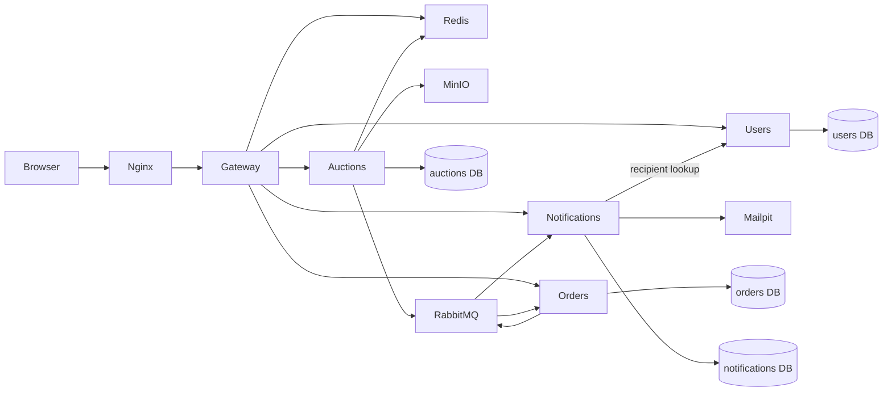

# Diamond Car Auction

A Java 21 and React marketplace for timed vehicle auctions. Local listings, accounts, and auction outcomes are fictional. Checkout is simulated.

## Run locally

Install Docker with Compose v2 and start Docker. From the repository root:

```sh
docker compose up --build -d --wait --wait-timeout 300
```

Open [Diamond Car Auction](http://localhost:8080). Local email is at [Mailpit](http://localhost:8025), traces at [Zipkin](http://localhost:9411), and queues at [RabbitMQ](http://localhost:15672). The first build compiles MinIO from its pinned [upstream release](https://github.com/minio/minio/releases/tag/RELEASE.2025-10-15T17-29-55Z).

| Role | Email |
| --- | --- |
| Buyer 1 | buyer1@diamond.test |
| Buyer 2 | buyer2@diamond.test |
| Seller | seller@diamond.test |
| Administrator | admin@diamond.test |

All local demo accounts use `DiamondDemo2026!`. Seeds and the quick-auction endpoint require the `dev` profile. Compose defaults to development. Copy `.env.example` to `.env` to override local defaults before creating volumes. Set AUCTION_CURRENCY before creating listings and keep it fixed for existing auction data. If port 8080 is occupied, set both APP_PORT and APP_ORIGIN in that file to match the new port. With Node 22+, reset the development demo with the command below. It deletes this Compose project's local auctions, users, orders, object storage and broker data.

```sh
node scripts/reset-demo.mjs
```

## Try it

- Open two browser profiles and sign in as the two buyers. Open the same live auction, submit a private maximum in one profile, and challenge it with a manual bid in the other.
- Sign in as the seller, create a draft with a JPEG or PNG cover, and submit it. Sign in as the administrator to review and approve it. The listed start time controls when bidding opens.
- With Node 22+, run `node scripts/demo.mjs` from the root. It creates a short-lived auction and asserts concurrent bid outcomes, idempotency, a deadline extension, automatic bidding, auction closure, one order, checkout, and notifications. The elapsed time is for that pair of local requests only.
- For a local failure drill, run `node scripts/demo.mjs --recovery`. It bids with RabbitMQ, orders, and notifications offline. It then stops the auction service until the deadline passes, restarts it to verify closure, and brings back the downstream services to verify outbox recovery. Check the winning account's notification center and Mailpit afterward.

## Services



Users owns identities and refresh sessions. Auctions owns listings, moderation, bids, watches, and closure. Orders materializes each sold auction into one purchase. Notifications consumes targeted events and persists inbox messages before attempting delivery. All four databases use separate roles and Flyway migrations. Frontend traffic uses a single origin through Gateway. The auction WebSocket is public and sends versioned snapshots containing only public fields. Private notifications and orders use authenticated HTTP.

## Bidding rules

- Before approval, the seller may edit a draft or a rejected submission. Submitting locks the draft. After approval, the schedule, vehicle, images, pricing, and reserve are fixed. Sellers may cancel only a scheduled or live auction without bids. Administrators can cancel a scheduled or live auction with a reason, including one with bids.
- Each accepted bid and closure acquires the auction row lock. The server samples the UTC clock after locking. Bids are accepted from the start time up to, but excluding, the end. A valid bid in the final 30 seconds sets the deadline to 30 seconds after acceptance.
- A manual bid commits its full amount as a price floor. The opening bid is the minimum for the first bid. Later challenging bids must meet the displayed price plus the increment. An incumbent can raise its maximum from the current price, and an existing maximum can only increase. Increasing a maximum gives it a new tie priority.
- The highest standing offer leads. Equal offers favor the first accepted at that amount. The public price is the existing floor (or the manual amount), raised as needed to the runner-up's offer plus the increment, capped at the leader's offer. With one bidder, an automatic bid leaves the price at the opening amount. Only the public price counts toward the reserve. The system never jumps directly to a private reserve.
- An idempotency key identifies an accepted request for that bidder and auction. Retrying it with the same mode and amount returns the original receipt. Reusing it with different input returns a conflict. Private amounts stay in auction storage and are absent from public responses, events, and WebSockets.
- Closing workers select due auctions with `FOR UPDATE SKIP LOCKED`. The transaction records one of sold, reserve not met, or no bids and writes its event. Orders and notifications usually appear shortly after the result.

## Verify

```sh
mvn -B -ntp verify
cd frontend
npm ci
npm run build
npx playwright install chromium
npm run e2e
```

Maven tests require Docker for PostgreSQL, RabbitMQ and Redis containers. The browser suite uses the running Compose stack in development mode. See [API and event contracts](API.md) for payloads and failed-message replay.

## Deployment notes

Use TLS, independent service and database secrets, a non-development Spring profile, secure cookies, a matching explicit origin, a supported and monitored object store, private infrastructure networks, backups, and monitored queue and outbox lag. Replace Mailpit and set a verified sender before any real email delivery. SMTP delivery is at least once if a process stops between SMTP acceptance and the database update. The local stack runs a single gateway, database server and broker. There is no real checkout, identity verification, escrow, or vehicle title transfer.

## Demo photography

These images illustrate fictional listings and do not depict inventory being offered for sale.

- Porsche 911 GT3 Touring, Alexander Migl. [Front photograph](https://commons.wikimedia.org/wiki/File:Porsche_992_GT3_with_touring_package_1X7A6142.jpg) and [second photograph](https://commons.wikimedia.org/wiki/File:Porsche_992_GT3_with_touring_package_1X7A1548.jpg), resized for the demo under [CC BY-SA 4.0](https://creativecommons.org/licenses/by-sa/4.0/).
- BMW M3 E46, Tokumeigakarinoaoshima. [Original photograph](https://commons.wikimedia.org/wiki/File:BMW_M3_coup%C3%A9_(E46)_front.JPG), resized for the demo under [CC0](https://creativecommons.org/publicdomain/zero/1.0/).
- Land Rover Defender, Rob Wingate. [Original photograph](https://unsplash.com/photos/a-black-land-rover-defender-shines-brightly-RSiiCx2RYK8), resized for the demo under the [Unsplash License](https://unsplash.com/license).
